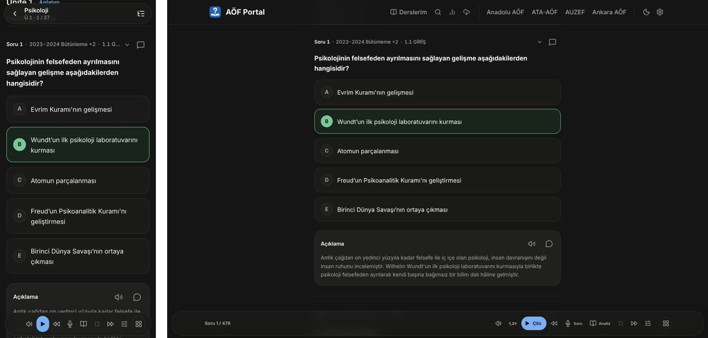
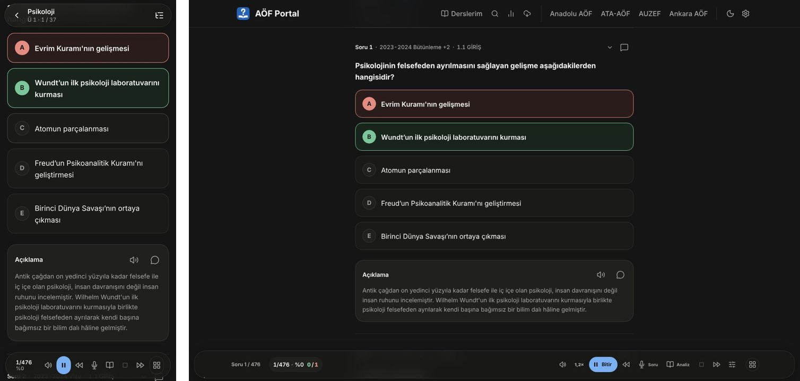
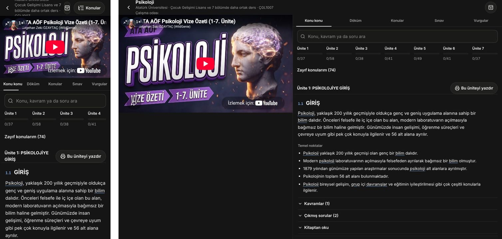
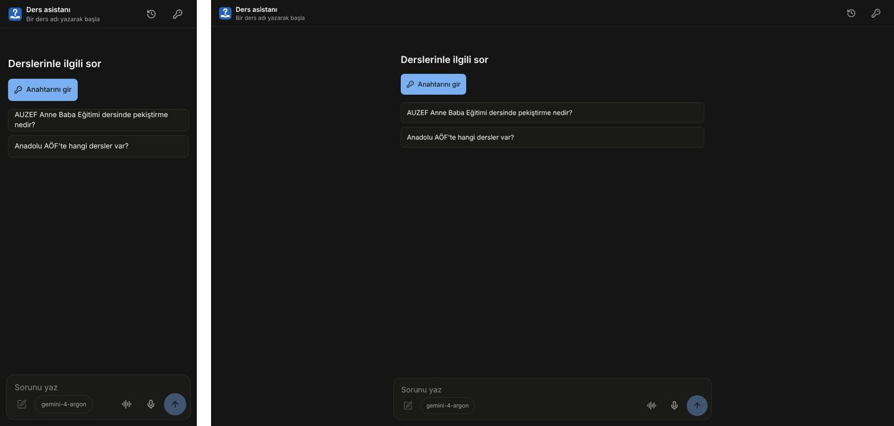
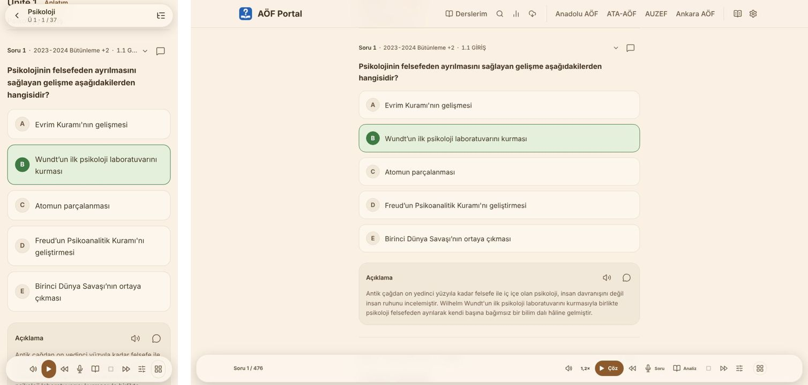
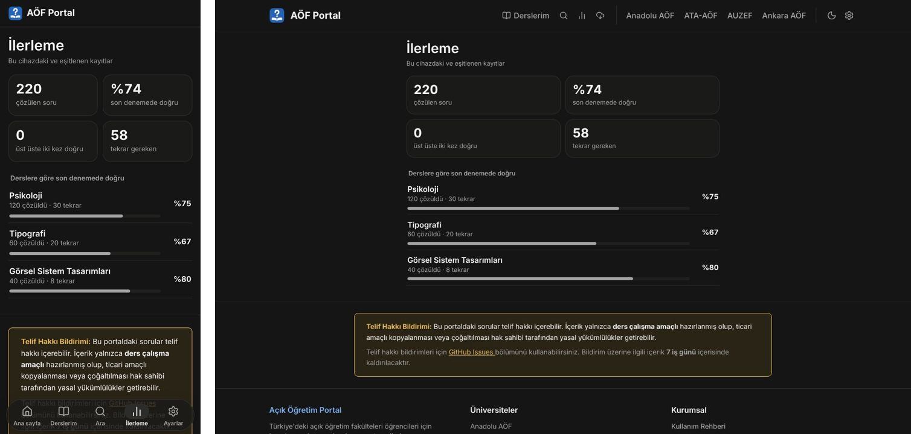
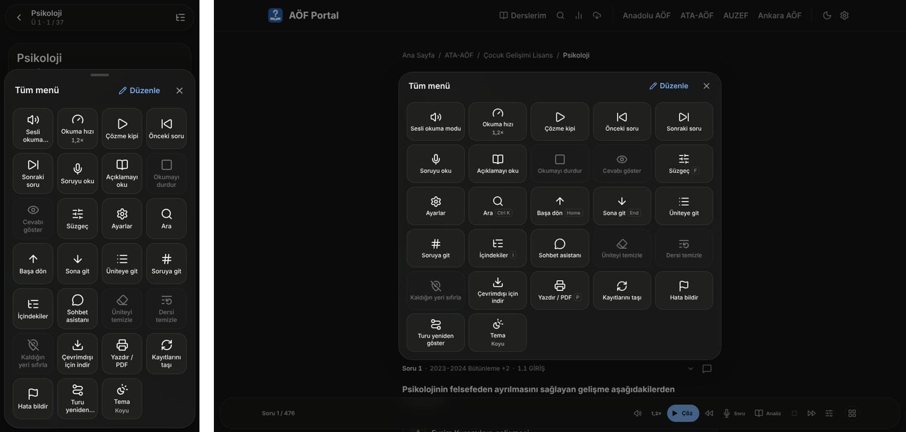

# Açık Öğretim Portalı: tanıtım ve portföy

**Canlı site**: https://acik-ogretim.github.io/ · **Kaynak kod**: açık kaynak, ücretsiz, reklamsız.

Açık Öğretim Portalı, Anadolu, Atatürk, İstanbul ve Ankara üniversitelerinin açık ve uzaktan öğretim öğrencileri için hazırlanmış çalışma sitesidir: ders ders çıkmış sorular ve açıklamalar, kitap konuları, özet videolu ders anlatımı, kendi anahtarınızla çalışan ders asistanı, ilerleme takibi ve internetsiz çalışma bir arada.

**Kimin için**: Açıköğretim fakültesi öğrencileri (sınavlara hazırlanan, telefondan çalışan, dinleyerek öğrenmek isteyen, odaklanma ya da görme güçlüğü yaşayan öğrenciler dahil), ders içeriği hazırlayan eğitmenler ve açık kaynak eğitim teknolojisiyle ilgilenenler.

## Rakamlar

Depodaki veriden sayılır: `node docs/tanitim/sayim.mjs` (sınama verisi hariç).

- **4** üniversite, **223** bölüm
- **10.983** ders kaydı (aynı ders birden çok bölümde geçtiği için tekil ders sayısı **4.468**)
- **921.022** soru (**599.765**'inde açıklama var, **122.346**'sı çıkmış sınav sorusu)
- **32** ders için çalışma odası (video, döküm, konu anlatımı) paketi: `ls src/data/calisma-odasi | wc -l`

Ana sayfadaki canlı sayaç (10.991 ders, 920.685 soru) derleme anına göre bu sayımdan küçük farklar gösterebilir.

## Öne çıkan özellikler

**Soru bankası ve ders sayfası**: Dersin bütün çıkmış soruları ünite sırasıyla, sınav künyesi, doğru cevap ve açıklamasıyla.



**Çözme kipi**: Şık seçince anında doğru-yanlış geri bildirimi, açıklama ve canlı sayaç.



**Süzgeç ve sıralama**: Yanlışlarım önce, çözmediklerim önce, sınav dönemine göre süz; seçime uyan soru sayısı canlı görünür. Masaüstü: [`suzgec-masaustu.jpg`](ekranlar/suzgec-masaustu.jpg), mobil: [`suzgec-mobil.jpg`](ekranlar/suzgec-mobil.jpg).

**Ders anlatımı (çalışma odası)**: Özet video, zaman kodlu döküm ve kitap konu anlatımı yan yana; kavram balonları, vurgu ve not, çıkmış sorularla sınav sekmesi.



**Kendi anahtarınla ders asistanı**: Dersin soruları, açıklamaları ve kitap konu ağacı üzerinden sohbet; anahtar tarayıcıda kalır.



**Sesli okuma ve kişiselleştirme**: Soru ve açıklamayı sesli okuma, hız ve ses seçimi; Açık, Koyu ve Sepya temalar.



**İlerleme ve Derslerim**: Çözülen soru, doğru oranı, tekrar gereken sayısı ve kaldığın yer (örnek kayıtlarla alınmış görüntü).



**Tüm menü**: Ders işlevlerinin tek menüde toplandığı, alt çubuğu kullanıcının kurduğu düzenlenebilir menü.



Her ekranın ayrı mobil (`<ad>-mobil.jpg`, 390x844) ve masaüstü (`<ad>-masaustu.jpg`, 1440x900) görüntüsü `ekranlar/` altındadır; bütün özellik listesi için [ozellikler.md](ozellikler.md).

## Teknik altyapı

Site Astro ile statik üretilir ve GitHub Pages'te yayınlanır; sunucu tarafı kod ve veritabanı yoktur. Soru ve ders verisi depodaki JSON dosyalarından derleme sırasında sayfalara dönüşür. Arayüz Tailwind CSS, React bileşenleri ve Base UI ile, yapay zekâ özellikleri TanStack AI ile tarayıcıda, kullanıcının kendi anahtarıyla çalışır. Çevrimdışı kullanım service worker ile sağlanır; tartışma ve hata bildirimi GitHub Discussions (giscus) ve GitHub issue formlarıyla yürür; ziyaret sayacı çerezsizdir (Cloudflare Worker).

## Gizlilik notu

Çözüm kayıtları, favoriler ve ayarlar varsayılan olarak yalnız kullanıcının tarayıcısında durur. İsteğe bağlı Google ile eşitlemede site, Google Drive'da yalnız uygulamaya özel, gizli bir klasör için izin ister; kullanıcının diğer Drive dosyalarını göremez. Yapay zekâ anahtarları siteye gönderilmez ve yedeğe girmez.

## Görüntüleri yeniden almak

```bash
node docs/tanitim/ekran-al.mjs            # hepsi
node docs/tanitim/ekran-al.mjs soru-bankasi cozme-kipi   # seçilenler
```

Playwright ve Chromium gerekir; `SITE` ortam değişkeni adresi değiştirir. İlerleme ve Derslerim görüntüleri betiğin tarayıcıda oluşturduğu örnek kayıtlarla alınır.
