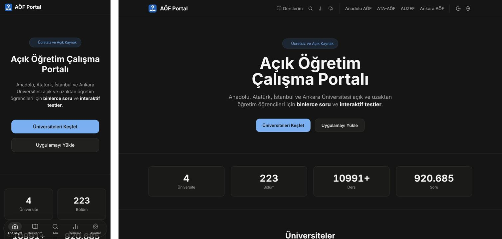
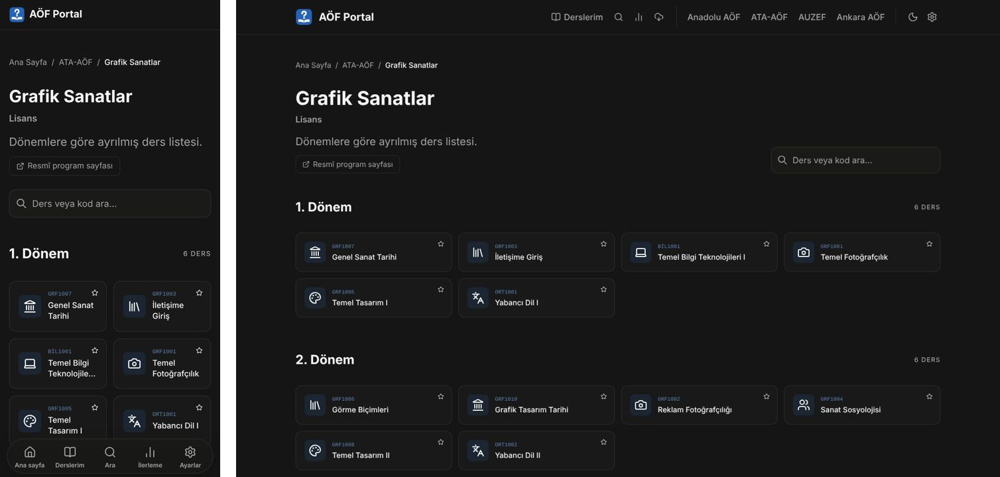
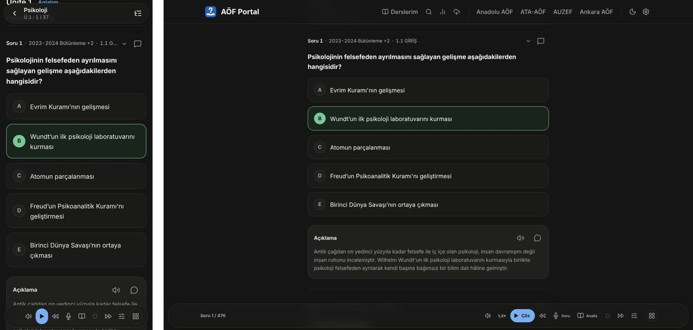
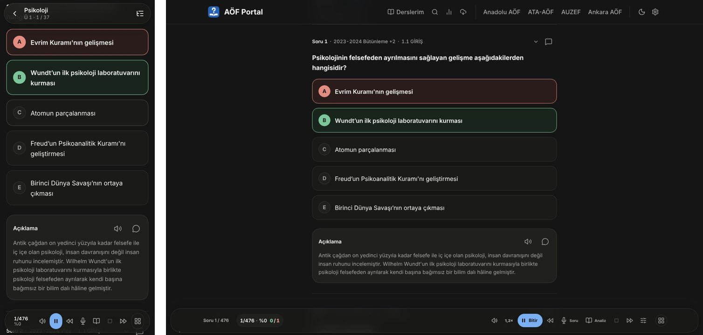
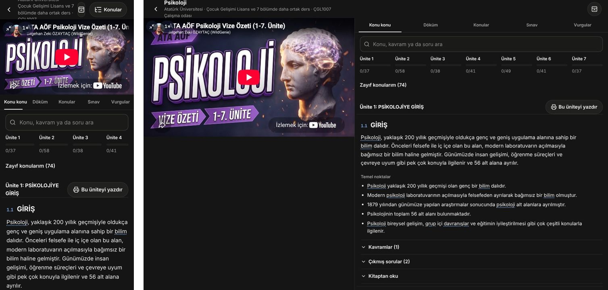
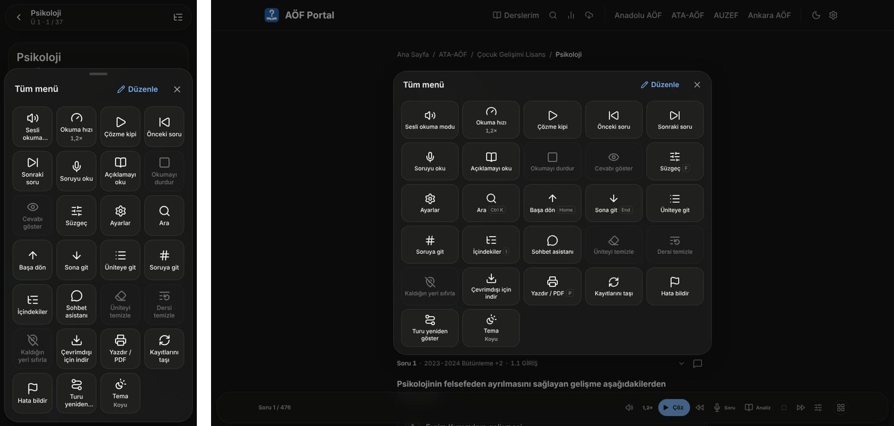
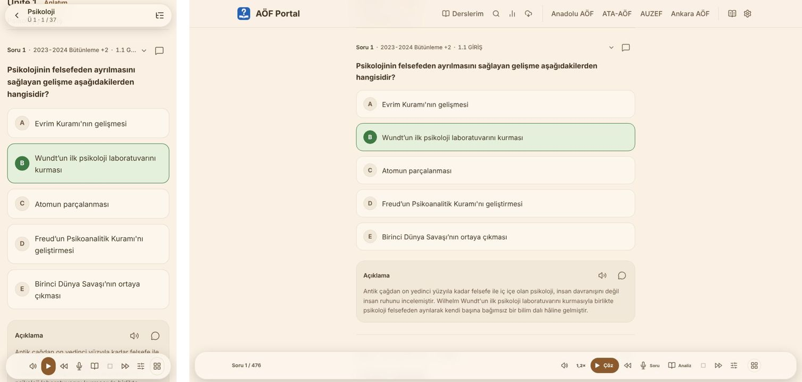
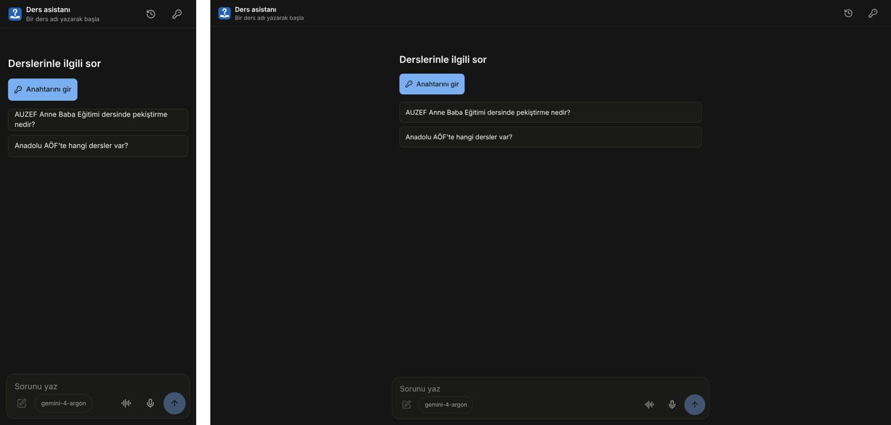

# Açık Öğretim Portalı için tasarım geri bildirimi

Merhaba, bu form Görsel İletişim Tasarımı bölümündeki arkadaşlarımızın gözünden portalın tasarımını değerlendirmek için hazırlandı. Açık Öğretim Portalı, Anadolu, Atatürk, İstanbul ve Ankara üniversitelerinin açık ve uzaktan öğretim öğrencileri için hazırlanmış ücretsiz bir çalışma sitesi: ders ders çıkmış soruları ve açıklamalarını çözebiliyor, kitap konularını okuyup özet videolarını dinleyebiliyor, ilerlemenizi takip edebiliyorsunuz. Site hem telefondan hem bilgisayardan kullanılıyor; bu yüzden iki görünüm yan yana verildi (solda telefon, sağda bilgisayar). Her ekranın altındaki sorulardan ilginizi çekenleri yanıtlamanız yeterli; kısa notlar da çok değerli. Site şu an koyu temada açılıyor, açık ve sepya (kâğıt rengi) seçenekleri de var.

Canlı site: https://acik-ogretim.github.io/

## 1. Ana sayfa

**Tipografi ve okunurluk**: Başlık, alt başlık ve rakam kartları arasındaki boyut farkı size dengeli geliyor mu? Alt başlıktaki gri yazı koyu zeminde rahat okunuyor mu?

**Görsel hiyerarşi**: Gözünüz ilk nereye gidiyor? "Üniversiteleri Keşfet" düğmesi yeterince öne çıkıyor mu, yoksa üstteki "Ücretsiz ve Açık Kaynak" etiketi mi dikkat çekiyor?

**Marka ve kimlik**: Sol üstteki logo ve "AÖF Portal" yazısı bir eğitim sitesinin güvenini ve sıcaklığını veriyor mu? Mavi vurgu rengi bu kimliği taşıyor mu?

## 2. Bölüm ve ders listesi

**Görsel hiyerarşi**: Dönem başlıkları, ders kartları ve ders kodları arasındaki sıra net mi? Kod yazısı (küçük, mavi) ders adının yanında gereksiz mi kalıyor, yararlı mı?

**Mobil kullanım**: Telefonda iki sütunlu kartlar ve uzun ders adlarının iki satıra kırılması rahat mı? Yıldız simgesi parmakla basılacak kadar büyük mü?

**Tipografi ve okunurluk**: Kartlardaki küçük yazı boyutları bilgisayarda da fazla küçük mü kalıyor?

## 3. Soru ekranı

**Tipografi ve okunurluk**: Soru metninin kalınlığı, şıkların boyutu ve açıklama kutusundaki gri yazı uzun süre okumaya uygun mu? Satır uzunluğu bilgisayarda doğru mu?

**Renk ve kontrast**: Doğru şıkkın yeşil çerçevesi ve açıklama kutusunun gri tonu yeterince ayrışıyor mu? Renk körlüğü olan biri için doğru cevap yalnız renkle mi anlaşılıyor?

**Mobil kullanım**: Altta yüzen oynatıcı çubuğu (ses, hız, ileri-geri, menü) başparmakla kullanılabilir mi? Soruyu ya da açıklamayı kapatıyor mu?

## 4. Soruyu çözerken geri bildirim

**Renk ve kontrast**: Yanlış şıkkın kırmızı ve doğru şıkkın yeşil tonları, koyu zeminde birbirine ve zemine göre yeterince net mi? Daha sakin ya da daha belirgin bir geri bildirim önerir miydiniz?

**Görsel hiyerarşi**: Doğru ve yanlış sonucu, açıklama ve üstteki sayaç (doğru/yanlış) arasında göz akışı doğal mı?

**Erişilebilirlik**: Öğrencinin yanıtı anlaması için renge ek olarak simge ya da etiket gerekir mi?

## 5. Ders anlatım ekranı (video, döküm, konu anlatımı)

**Görsel hiyerarşi**: Video, sekmeler (Konu konu, Döküm, Konular, Sınav, Vurgular) ve metin arasındaki düzen karışık mı, yoksa takip edilebilir mi?

**Mobil kullanım**: Telefonda video ekranın üst yarısını kaplıyor; geriye kalan alan okuma için yeterli mi? Üstteki başlık satırı kesik görünüyor, bunu siz de fark ettiniz mi?

**Tipografi ve okunurluk**: Konu metni, "Temel noktalar" maddeleri ve altı çizili kavramlar uzun okuma için rahat mı? Kavram altı çizgisi metni bozuyor mu?

## 6. Tüm menü

**Görsel hiyerarşi**: Yirmiden fazla düğme tek menüde toplandı. Gruplama (okuma, soru, ders işleri) sizce yeterince anlaşılıyor mu, yoksa sıralama kafa karıştırıyor mu?

**Marka ve kimlik**: Simgelerin çizgi kalınlığı ve stili birbiriyle ve logoyla uyumlu mu? Kullandığımız simge dili eğitim konusuna uygun mu?

**Erişilebilirlik**: Soluk görünen (kullanılamayan) düğmeler ile aktif düğmeler birbirinden ayırt ediliyor mu?

## 7. İlerleme

**Görsel hiyerarşi**: Üstteki dört büyük rakam (çözülen soru, doğru oranı, üst üste iki doğru, tekrar gereken) öğrenciye motivasyon veriyor mu, yoksa sayılar fazla mı kuru?

**Renk ve kontrast**: Çubukların ve yüzdelerin tek renkli olması yeterli mi? Başarıyı vurgulayan bir renk ya da çizim önerir miydiniz?

**Marka ve kimlik**: Bu ekran diğer ekranlarla aynı dili konuşuyor mu, yoksa daha sıkıcı mı kalıyor? (Görüntü örnek kayıtlarla alındı.)

## 8. Sepya tema

**Renk ve kontrast**: Kâğıt rengi zemin ve kahverengimsi vurgu uzun süre okumada göz yormuyor mu? Yazı ile zemin arasındaki fark yeterli mi?

**Tipografi ve okunurluk**: Aynı yazı tipi üç temada da (koyu, açık, sepya) doğru çalışıyor mu? Hangi temada en rahat okudunuz?

**Marka ve kimlik**: Temalar arasında geçişte sitenin kimliği korunuyor mu, yoksa üç ayrı site gibi mi duruyor?

## 9. Ders asistanı (sohbet)

**Görsel hiyerarşi**: Boş sohbet ekranında "Anahtarını gir" düğmesi ve örnek sorular öğrenciyi doğru yere yönlendiriyor mu? Ekran fazla boş mu?

**Mobil kullanım**: Alttaki yazı alanı, mikrofon ve gönder düğmeleri parmakla kullanıma uygun mu?

**Marka ve kimlik**: Bir yapay zekâ asistanı için sıcak ve güven veren bir görünüm mü, yoksa ayrı bir uygulama gibi mi duruyor?

## Genel sorular

**Genel izlenim**: Siteyi üç kelimeyle anlatsanız bunlar ne olurdu? Bir eğitim sitesi gibi duruyor mu?

**Tutarlılık**: Düğme biçimleri, köşe yuvarlaklıkları, boşluklar ve renkler ekranlar arasında tutarlı mı?

**Yazı tipi**: Kullandığımız yazı tipi (sade, başlıklarda kalın) kimliğe uygun mu? Başlık için ayrı bir yazı tipi önerir miydiniz?

**Koyu tema**: Koyu temanın ilk açılış teması olması doğru mu, yoksa açık tema mı varsayılan olmalı?

**Erişilebilirlik**: Yazı boyutu, kontrast ya da hareket konusunda gözünüze çarpan bir eksik var mı?

**Eksik olan**: Sitede görmek isteyip bulamadığınız bir şey var mı?

## En çok neyi değiştirirdiniz?

Sizce tek bir değişiklik yapılabilseydi, hangisi sitenin tasarımını en çok iyileştirirdi? Lütfen ekranı ve gerekçenizi yazın; varsa küçük bir çizim ya da örnek site bağlantısı ekleyin.

**Cevabınız**:

**Adınız (isterseniz)**:
